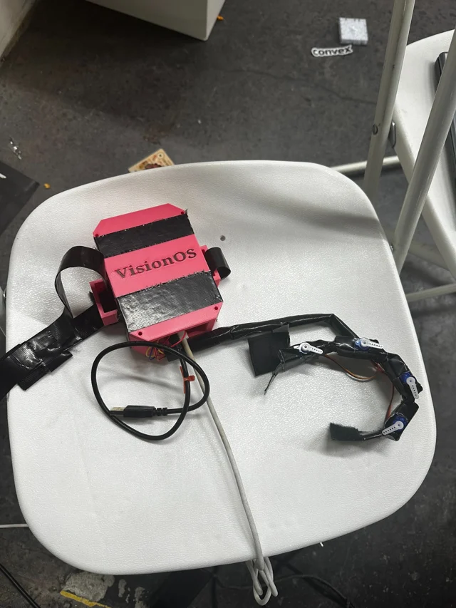
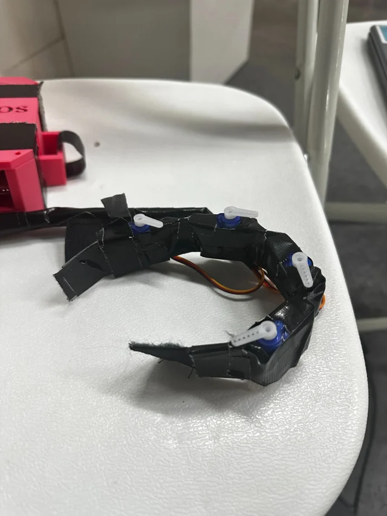
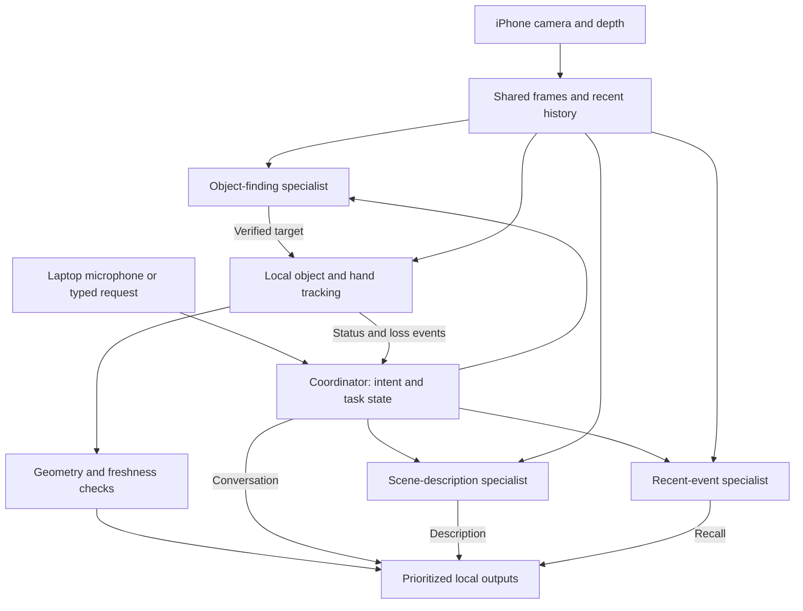

<div align="center">

# VisionOS

### More of the world. Within reach.

Assistive hardware exploring object finding, scene understanding, and wearable feedback for blind and low-vision people.

[](#about)
[](#project-status)
[](https://github.com/yukevindai/VisionOS/actions/workflows/agent-tests.yml)
[](LICENSE)

[Get started](#get-started) · [Architecture](#how-it-works) · [Documentation](#documentation) · [Contribute](#contributing)




*The current hardware prototype. Photos show the assembly, not user testing.*

</div>

## About

Finding your cup. Understanding what is on a table. Following a shared moment.

VisionOS started at **Cal Hacks 13** to explore how AI can make everyday visual context available through speech and wearable feedback. The wearable is the product we are building; an iPhone and laptop support today's prototype.

This repository includes the hardware firmware, Python vision and agent runtime, local demonstration dashboard, native iPhone application, optional friend-viewing infrastructure, and public company website. **VisionOS is the project name; the native app targets iPhone, not Apple's visionOS platform.**

## What you can explore

| Capability | Implementation |
| --- | --- |
| **Find an object** | Natural-language requests use local detection and Gemini verification, followed by local target tracking. Ambiguous requests can prompt clarification. |
| **Guide a reach** | Hand tracking and target geometry produce local directional cues. Physical distance guidance requires valid depth and calibration. |
| **Describe surroundings** | A visual specialist answers questions about a current camera frame and returns a spoken description. |
| **Recall recent events** | “What did I miss?” uses a bounded, memory-only history of recent frames and pipeline events. It reports insufficient evidence rather than guessing. |
| **Use voice controls** | Windows speech recognition supports requests, “Hey Vision,” “Thanks Vision,” and local Stop handling. Typed controls remain available. |
| **Show the demo** | A local browser dashboard displays the camera, tracking information, guidance, and agent activity alongside the desktop interface. |
| **Explore wearable feedback** | An optional Arduino 101 BLE adapter and servo-controller firmware connect the hardware work to the laptop runtime. Physical behavior needs device validation. |

The native iPhone implementation also retains task, guidance, target, and Bluetooth packages. The separate friend viewer supports authenticated, watch-only assistance; see its setup guide before using it.

## How it works

The iPhone supplies camera frames and available depth through PathOn. The laptop receives microphone input, runs local perception, calls AI providers when needed, and manages audio output.



**Reasoning happens on demand; tracking stays local.** Anthropic handles intent routing and optional complex-request escalation. Gemini supports visual interpretation. Obvious commands can bypass intent inference, and Stop does not wait for a cloud response.

All visual specialists share one frame service. Task generations, frame identifiers, timeouts, and bounded queues prevent cancelled or outdated results from restarting work. Model text enters the conversation path; it cannot authorize movement or directly drive the wearable.

Conversational speech can use **Cartesia**, with Windows speech fallback. Immediate movement and loss cues remain local. See the [orchestration guide](docs/MULTI_AGENT_ORCHESTRATION.md) for model configuration, audio priorities, and recent-frame limits.

## Get started

Choose the part of VisionOS you want to run:

| Entry point | Requirements | Guide |
| --- | --- | --- |
| **Live hardware demo and agents** | Compatible Windows Python environment, vision models, iPhone/PathOn, provider credentials; calibration for measured guidance | [Laptop demo](docs/MULTI_AGENT_ORCHESTRATION.md) |
| **Dashboard design preview** | Python 3; no camera, credentials, or vision dependencies | [Dashboard](apps/demo-dashboard/README.md) |
| **Company website** | Node.js 22+; Python 3 for the preview server | [Website and Vercel setup](apps/website/README.md) |
| **Native iPhone app** | macOS, Xcode, iOS 17+; feature-specific configuration | [iOS setup](ios/README.md) |
| **Friend video viewer** | Configured Auth0, Convex, and LiveKit services | [Video sharing setup](docs/LIVE_VIDEO_DEMO_SETUP.md) |

### Live laptop demo

1. Follow the [tracking prerequisites](backend/LIVE_TRACKING.md) to prepare a compatible Python environment, detector/tracker models, and the PathOn stream. The live requirements file alone is not the complete vision setup.
2. Copy [`backend/.env.example`](backend/.env.example) to `backend/.env` if you do not already have one. Set `GEMINI_API_KEY`, `GEMINI_MODEL`, `ANTHROPIC_API_KEY`, and `ANTHROPIC_HAIKU_MODEL` for agent mode. Keep existing local configuration and never commit credentials.
3. Verify the model IDs and start the demo with your actual environment and phone address.

From the repository root, in PowerShell:

```powershell
# Replace these values with your existing vision environment and actual configuration.
$VisionPython = "C:\path\to\vision-env\Scripts\python.exe"
$PhoneAddress = "YOUR_PATHON_IP"
$GeminiModel = "YOUR_VERIFIED_GEMINI_FLASH_ID"

Push-Location backend
& $VisionPython -m r3_vision.agent_providers verify-models
Pop-Location

.\backend\start-live-tracking.ps1 -Agents -WebDashboard -Audio -Voice `
  -Python $VisionPython -PhoneHost $PhoneAddress `
  -Model $GeminiModel -Detection hybrid
```

Open **http://127.0.0.1:8765** on the same laptop. Try **“Find the cup,” “Describe surroundings,”** or **“What did I miss?”** Use **“Stop”** to cancel the current task.

Retain your existing `-DistanceCalibration`, `-VoiceInputDevice`, and `-AudioDevice` arguments when applicable. Agent mode supports `hybrid` and `gemini` detection; the legacy `demo` and `allobjects` modes remain available without `-Agents`. Optional `-ArduinoBLE` and `-ArduinoAddress` flags select the hardware adapter; install [BLE dependencies](backend/requirements-ble.txt) in the same environment and review the [firmware instructions](firmware/Arduino101ServoController/README.md).

### Preview the dashboard without hardware

```sh
python -m http.server 8766 --bind 127.0.0.1 --directory apps/demo-dashboard
```

Open **http://127.0.0.1:8766/?preview=active**. This explicitly labeled **SIMULATED** preview demonstrates the interface and does not issue hardware commands.

### Run the company website

```sh
cd apps/website
npm run build
npm run preview
```

Open **http://localhost:3000**. There are no npm dependencies to install. For Vercel, use `apps/website` as the project root and `dist` as the output directory; see the [deployment configuration](apps/website/README.md).

The company website is a public product and mission page. It does not operate the hardware. The live dashboard is a separate, loopback-only laptop interface and should not be exposed through a public tunnel.

## Repository map

| Path | Purpose |
| --- | --- |
| [`apps/demo-dashboard/`](apps/demo-dashboard/) | Local audience/operator dashboard for the Python demo |
| [`apps/website/`](apps/website/) | Public company website and Vercel build configuration |
| [`apps/friend-web/`](apps/friend-web/) | Authenticated watch-only browser helper |
| [`backend/r3_vision/`](backend/r3_vision/) | Camera integration, visual agents, orchestration, tracking, audio, and BLE adapter |
| [`backend/hand_tracking/`](backend/hand_tracking/) | Hand and fingertip tracking |
| [`backend/convex/`](backend/convex/) | Authentication, sharing/media state, vision and speech actions |
| [`backend/eval/`](backend/eval/) | Offline and recorded-image evaluation tools |
| [`ios/App/`](ios/App/) | Native SwiftUI application and platform adapters |
| [`ios/Packages/`](ios/Packages/) | Guidance, Tasks, Targets, HapticLink, and preserved perception research |
| [`ios/VisionOS.xcodeproj/`](ios/VisionOS.xcodeproj/) | Native iPhone project; shared scheme: `VisionOS` |
| [`firmware/`](firmware/) / [`hardware/`](hardware/) | Device firmware and hardware resources |
| [`contracts/`](contracts/) / [`fixtures/`](fixtures/) | Cross-team interfaces and shared test inputs |
| [`docs/`](docs/) / [`ios/Validation/`](ios/Validation/) | Architecture, build specifications, setup, and validation records |
| [`.github/workflows/`](.github/workflows/) | Agent/demo and iOS checks |

The [ownership guide](docs/REPOSITORY_STRUCTURE.md) explains integration boundaries. The [DeskGuide laptop research prototype](ios/Packages/Perception/Prototypes/DeskGuide-Laptop/README.md) is preserved with its own evaluation tools, dependencies, and records.

## Project status

**Early prototype.** Features above describe code present in the repository, not a claim of completed live acceptance or a production-ready assistive device.

- Automated agent tests use mocked providers, generated/replayed frames, and fake tracker/audio interfaces. They do not establish live model, microphone, LiDAR, speaker, or wearable performance.
- The guidance path requires fresh evidence within its 300 ms limit. Missing depth remains unknown; near-object geometry is not proof of contact or a successful grasp.
- Recent-event recall uses visual observations, not recorded ambient audio. It cannot establish unseen causes, conversation, emotion, or intent.
- Voice recognition runs on Windows. “Hey Vision” resumes request handling; it does not wake a sleeping computer. Closing the demo or omitting voice mode stops its microphone recognition.
- Hardware calibration, interruption behavior, connection loss, and device output require testing on the actual setup.

Current checks and their logs are available in [GitHub Actions](https://github.com/yukevindai/VisionOS/actions). Required-check success is not a full iOS, accessibility, or live-device pass.

## Documentation

- [Multi-agent runtime, voice, and audio](docs/MULTI_AGENT_ORCHESTRATION.md)
- [Live camera and PathOn setup](backend/LIVE_CAMERA.md)
- [Tracking modes and troubleshooting](backend/LIVE_TRACKING.md)
- [Directional distance and calibration](docs/DIRECTIONAL_DISTANCE_GUIDANCE.md)
- [Backend services](backend/README.md)
- [Native iPhone setup and tests](ios/README.md)
- [Build specification](docs/Cal_Hacks_13_Build_Spec_v3.md) · [R2 implementation specification](docs/R2_IOS_IMPLEMENTATION_SPEC.md)
- [Validation records](ios/Validation/)
- [Dashboard Figma design](https://www.figma.com/design/JnmjymGdRQGturYhNuQcwo?node-id=3-138) · [Company website Figma design](https://www.figma.com/design/nsDazJM8jtWNRUM9JJT0SS?node-id=2-134)

Build specifications also contain planned scope; use implementation and validation records to distinguish plans from tested behavior.

## Contributing

Read [`AGENTS.md`](AGENTS.md) and the [ownership guide](docs/REPOSITORY_STRUCTURE.md) first. Start a fresh branch from current `main`, keep changes focused, and open a pull request. Merges require one approval and the required checks. Preserve existing features unless a removal is explicitly requested.

For the Python runtime and dashboard, after installing the appropriate dependencies:

```sh
cd backend
python -m unittest discover -s tests
cd ..
node --test apps/demo-dashboard/state.test.js
```

The desktop test suite needs Tkinter and a display; Linux CI supplies Xvfb. Native checks and platform-specific commands are documented in [`ios/README.md`](ios/README.md). Report simulated and live validation separately, including skipped or unavailable checks.

Local relay/handoff files, credentials, recordings, and generated model artifacts follow the repository's ignore rules. Do not force-add them.

## License

Repository code is available under the [MIT License](LICENSE). Third-party models and dependencies retain their own terms, including the [native model notice](ios/Resources/Models/NOTICE.txt). Check those notices before redistributing model assets.

---

<div align="center">

<strong>Assistive technology, built around people.</strong><br>
<a href="https://github.com/yukevindai/VisionOS/issues">Questions, feedback, and collaboration</a>

</div>
