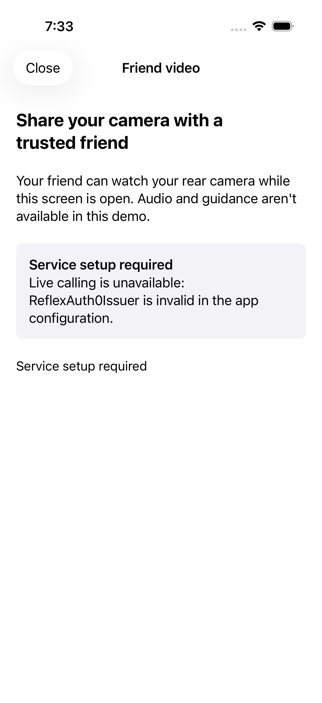

# Native owner and browser helper video demo — October 24, 2026

## Outcome

Implemented the missing user-authorized native camera adapter and a separate owner video flow, connected to the existing Convex/LiveKit media coordinator. Added a watch-only browser helper. These pieces compile locally; **no real iPhone-to-helper call has been observed**. Convex, Auth0 and LiveKit projects/configuration and an available physical iPhone are still required. Follow [the setup guide](../../docs/LIVE_VIDEO_DEMO_SETUP.md).

The user explicitly authorized the minimal native camera adapter after branch inspection showed R1's pushed work is a laptop prototype. `feature/reflex-hand-guidance` (`b9e99f7`) and `feature/reflex-modular-ui` (`6bf9f1f`) were fetched/read without merging or editing. Teammate ScreenModel, Target Selector and Gemini work remain untouched.

## Product changes

- `NativeCameraFrameSource`: one rear AR session for the exclusive demo, original pixel buffers and monotonic capture timestamps, bounded frame delivery, interruption/background/Stop closure. No microphone, depth, target interpretation or guidance.
- `Auth0NativeIdentity` and `LiveServiceConfiguration`: Auth0.swift PKCE/Keychain ID-token credentials, account invalidation and public-only local settings. Auth0 2.25.0 and SimpleKeychain 1.3.0 pinned in the generator; the latter is linked explicitly because app-side default arguments reference its symbols when Xcode emits dynamic package products.
- Owner screen: sign-in, invitation creation, pending-request pagination and explicit approval, per-session sharing consent, Start/End. Home entry is available when ordinary assistance is idle/ended/failed, and the full-screen flow excludes concurrent normal assistance. Pending startup is invalidated when backgrounded; Auth0's inactive permission/login sheet alone does not cancel sign-in.
- Coordinator now accepts optional per-session sharing configuration and exposes observable state. It enables sharing before its initial server snapshot; persistent automatic-sharing preference is untouched.
- `assistance.helperStatus`: helper-scoped, nonce-correlated status with current room generation and provider-confirmed owner/helper SIDs. Two tests cover membership/projection/no renewal and auth/expiry/revocation closure.
- `apps/friend-web`: Auth0 + Convex login, invitation redemption, paginated discovery, reserve/join, exact verified owner-camera subscription and Leave. No capture, audio, target clicking or AI. Local deadlines and invalidation clear the viewer and require a fresh explicit join.

GPT-6 Sol handled native auth/owner UI and the browser implementation; GPT-6 Astra handled the camera and focused integration review. Parent integrated backend status, configuration, project, tests and documentation. Review found and addressed pending-start background closure and the otherwise-inaccessible demo after normal assistance fails.

## Actual validation

| Check | Result / evidence |
| --- | --- |
| Backend tests | **92 passed across 10 files**, `/tmp/r2-live-flow-backend-tests.log` |
| Backend typecheck / offline codegen | Exit 0, `/tmp/r2-live-flow-backend-typecheck.log`, `/tmp/r2-live-flow-codegen.log`; no cloud deployment |
| Helper frozen install, typecheck, production build | Passed by helper agent with dummy public config; real env remains absent. Vite reported a dependency directive warning and large bundle warning. |
| Integrated iOS app tests | **100 passed**, final `/tmp/r2-live-flow-final-integrated.log` and `.xcresult` |
| New owner entry/Close UI test | Passed against final source in the same final result bundle |
| Simulator regression smoke | **4 passed**, `/tmp/r2-live-flow-final-ui.log` and `.xcresult`: new entry/Close plus simulation Start/Pause/Resume/End, largest text controls and camera denial recovery. Ran before final startup-state/UI-copy changes; new entry rerun afterward. |
| Unsigned Release iPhone build | **Passed**, `/tmp/r2-live-flow-iphone-release.log`; compilation, not installation or device validation |
| Initial integrated build failure | Missing SimpleKeychain linker symbols, `/tmp/r2-live-flow-integrated-unit.log`; fixed through explicit package linkage and subsequent passing builds |
| Browser inspection | Actual `http://localhost:5173` missing-config screen observed. No authenticated browser/provider flow tested. |
| Device inventory | iPhone 14 Pro Max “Kraft Dinner” unavailable; no physical test |
| Scheme and local files | User scheme SHA256 `540920b42c01d7e87b818a3281cdddf9a71b2ba065ed982bc5972028a7c8f511` preserved; local relay/handoff remain ignored/untracked |

Xcode's captured simulator screenshot confirms the new screen and honest service-setup state:

The screenshot is from XCTest, not a real video feed. A manual Simulator automation connection timed out; no manual simulator inspection is claimed. No full accessibility audit was rerun. Earlier five unsuppressed contrast failures remain historical unresolved findings.

## Remaining acceptance

Create/configure the services, complete normal Convex deployment analysis, sign/install on a connected ARKit-capable iPhone, and use two real accounts. Verify invitation → owner approval → consent/Start → helper discovery/Join → moving camera pixels with correct orientation → End clears helper. Observe webhook reconciliation and real network timing. Repeat closure on background/dismiss/leave/logout and confirm a new explicit Start/Join is required.

Shared microphone/remote audio, worker, normal R1 assistance, and teammate R3 integration remain outside this demo. Existing unresolved media limits still apply: frames already handed to WebRTC and SDK internal reconnect/republish behavior need real-device fault testing. No camera/audio coexistence, actual provider eviction, latency or hardware-safety acceptance is inferred from these tests. No API keys were read, projects created, cloud code deployed, commits pushed or teammate messages sent in this slice.
