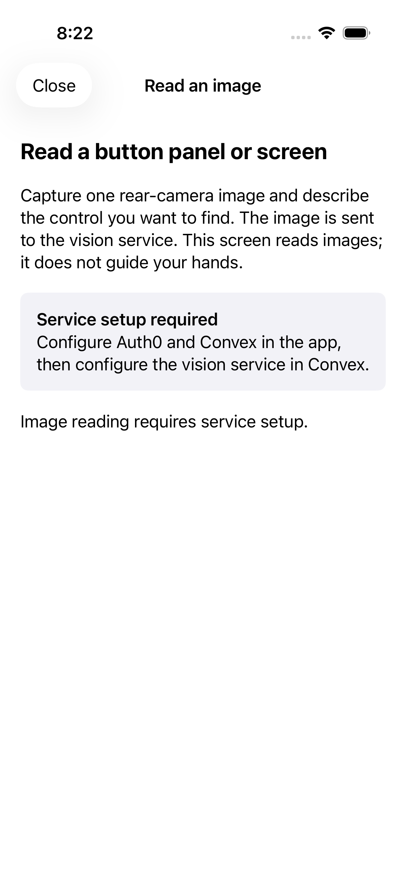

# Native R1/R3 integration — October 24, 2026

Status: implemented and locally validated; **not installed or tested on a physical iPhone**. The user authorized adding missing native integration so the phone performs camera, LiDAR, tracking, hand guidance and local Stop without a laptop. Cloud services remain permitted. Nothing in this record establishes safe real-world navigation or guidance.

## Connected paths

- Normal assistance uses one native ARKit session, scene depth and its confidence map, Vision hand pose/tracking, local Core ML object detection, Tasks state transitions, and the native Guidance controller/audio scheduler. It currently accepts cup/can, bottle and bowl requests. The original teammate YOLO11s weights are hash-verified and converted locally; the R1 Python prototype is unchanged. Swift geometry/controller tests include recorded numerical parity fixtures from the prototype.
- R3's Targets package supplies canonical target matching, normalized bounding boxes and the provider ScreenModel. Tasks retains its separate task-specific `TaskScreen`. The duplicate task label-selection logic now calls the canonical selector.
- The separate **Read an image** route sends an explicitly captured snapshot through authenticated `vision:readScreen` to the teammate Gemini pipeline. Its result is semantic evidence, not authorization for movement. Cloud results do **not** currently drive the normal physical guidance flow. The R3 evidence adapter rejects missing physical confidence/safety classifications.
- The friend-video route remains separate and exclusive. Actual Convex/Auth0/LiveKit and hosted Python vision configuration are still needed. No backend deployment or real friend call was performed.

## Limits preserved

Guidance requires current measured target/hand depth, valid confidence, normal tracking and a working offline Stop listener. Stale frames, cancellation, session/generation changes, tracking discontinuities and significant hand occlusion stop output. The initial occlusion/continuity thresholds are conservative and uncalibrated; small targets may stop before contact. Image overlap does not prove grasp or press. The port supplies no free-space/approach/door-passage authorization. H1 configuration, wristband validation, Claude intent tools and Cartesia remain absent. Native speech recognition ending or failing pauses assistance; continuous-session recovery needs live testing.

The model binary is ignored. Follow [model preparation](../README.md) before building a fresh clone. Source hash, export configuration and compiled file hashes are recorded in `Resources/Models/model-manifest.json`; the upstream AGPL notice is retained. CI now has an export step; the updated hosted workflow has not been run.

## Actual validation

| Check | Result and scope |
|---|---|
| App tests on iPhone 17 Pro simulator, iOS 26.5 | 136 passed, including target adapters, cancellation, geometry and audio output policy. Bundled Core ML load/inference ran on a synthetic blank image; not object accuracy. |
| Image-reader UI | Two tests passed: entry/Close keeps assistance idle and simulation hides the live reader. Screenshot exported and inspected. |
| Swift package tests | Tasks 92, Guidance 11 and Targets 20 passed during this integration. No new HapticLink hardware result. |
| Backend | 100 TypeScript tests, typecheck and offline codegen passed; final Python suite 43 passed after credential redaction/thinking-level changes. |
| Unsigned Release iPhone build | Passed. |
| Signed Debug iPhone build | Passed with the existing local development team. |
| Device installation | Failed before installation: CoreDevice error 12040, missing DDI hardware variant (0xe800010f). |
| Live Gemini | One successful real provider request on a synthetic panel; details below. No actual camera image, hosted bridge or iPhone network test. |

Local logs: `/tmp/reflex-native-integrated-tests-3.log`, `/tmp/reflex-native-reader-ui.log`, `/tmp/reflex-native-final-tests.log`, `/tmp/reflex-native-final-release.log`, `/tmp/reflex-native-signed-build.log`, `/tmp/reflex-native-device-install.log`, `/tmp/r3-bridge-backend.log`, `/tmp/r3-credential-redaction-python-tests.log`. Earlier compile failures in the first two integrated attempts were corrected; they are not passing results.

## Gemini provider check

The key is stored only in ignored local server configuration, with owner-only filesystem permissions. The user chose Gemini 3.8 Flash after 2.5 Flash returned 404. There is no automatic model fallback.

| Request | Outcome |
|---|---|
| List models | HTTP 200. This did not establish model-generation access. |
| Gemini 2.5 Flash, synthetic panel | HTTP 404, explicit provider-unavailable result. |
| Gemini 3.8 Flash, default effort, same panel | Timed out at approximately 5.04 seconds, explicit provider-unavailable result. |
| Gemini 3.8 Flash, low effort, same panel | HTTP 200, 2.34 seconds total, recognized labels “1” and “2” and selected “2”. |

The successful result is in [the recorded response](Evidence/2026-10-24-native-r1-r3/gemini-3.8-low-synthetic-panel.json). Input was generated test artwork, not a camera image. One measurement is not a latency guarantee or accuracy benchmark. The five-second application timeout remains enforced. Gemini supplies no fabricated confidence or physical safety approval.

## Physical device blocker and next test

The connected phone reports iOS 27.2 beta and Developer Mode enabled. The Mac has Xcode 26.6 and macOS 26.5.1. Refreshing the installed developer images left the same unsupported image; both developer-service startup and app installation failed. Apple lists Xcode 27.2 with iOS 27.2 support and a macOS 26.6 minimum: [Xcode requirements](https://developer.apple.com/xcode/system-requirements).

After compatible tooling is installed, first run the DEBUG-only `--native-device-check` route. It shows real camera/depth/hand counters with no movement cues, audio or cloud uploads. Then validate orientation, dominant-hand identity, depth uncertainty, target occlusion, offline Stop, interruption/restart, inference latency and continuous speech on the physical device. Do not count simulator checks as these device passes. Deploy/configure the authenticated cloud services separately before claiming laptop-free Gemini or friend video.

